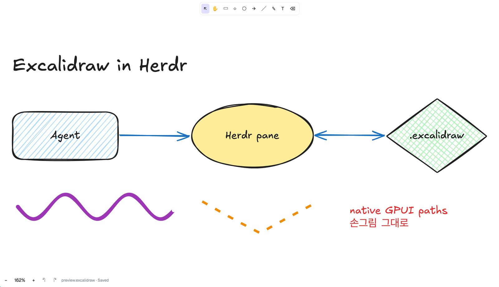

# herdr-excalidraw



An Excalidraw editor for the [Herdr](https://herdr.dev) desktop app, as a mod pane. It opens
`.excalidraw` files, draws them the way Excalidraw does (same hand-drawn shapes, from
Excalidraw's own `@excalidraw/element` package), edits them, and saves back to the file.

Herdr mods have no web view, so this is not the Excalidraw web app in a frame: shapes are
native GPUI paths, text is native text, and the editing UI is written for Herdr.

## Install

`mods/excalidraw/` is the built mod, committed. Any of:

- Ask your agent: `Read ~/.config/herdr-app/AGENTS.md, then add this mod: herdr.dev/mods/coyaSONG/herdr-excalidraw`
  (or this repository's URL). The build of it is described in [RECIPE.md](RECIPE.md).
- Copy `mods/excalidraw` to `~/.config/herdr-app/mods/excalidraw`.
- From source: `bun install` (or `npm install`), then `node build.mjs --install`. This rebuilds
  `mods/excalidraw/` and copies it to `~/.config/herdr-app/mods/excalidraw`
  (`$HERDR_APP_HOME/mods/excalidraw` if set).

Herdr hot-reloads the mod. It brings the Excalifont font in `fonts/`; Herdr loads mod fonts at
start and on the next look change, so restart Herdr (or switch theme) once after the first
install, or text falls back to the UI font.

## Open a drawing

```sh
bin/herdr-excalidraw drawing.excalidraw          # beside the focused pane
bin/herdr-excalidraw --down drawing.excalidraw
bin/herdr-excalidraw --tab drawing.excalidraw
```

or directly:

```sh
herdr-app do pane.split --direction right --mod excalidraw --props '{"file":"/abs/path/drawing.excalidraw"}'
```

A file that does not exist opens empty and is created on the first change. Changes save
about half a second after each edit. When the file changes on disk (another editor, an
agent, `git checkout`), the pane reloads it; if you had unsaved changes, a notification
says so and undo brings them back.

## Editing

| Tool | Key | |
|---|---|---|
| Select | `v` `1` | click, shift-click, drag a box; drag to move; double-click text or a shape to edit its text |
| Hand | `h`, or hold `space` | drag to pan; the middle button pans with any tool |
| Rectangle, diamond, ellipse | `r` `2`, `d` `3`, `o` `4` | drag; shift for a square/circle |
| Arrow, line | `a` `5`, `l` `6` | drag; arrow ends dropped on shapes bind to them |
| Draw | `p` `7` | freehand |
| Text | `t` `8` | click, type, `escape` or click outside to finish |
| Eraser | `e` `0` | click or drag over elements |

- `backspace`/`delete` deletes the selection, arrow keys nudge it (shift: 10), `enter` edits
  the selected text, `escape` clears the selection, `cmd-a` selects all.
- `cmd-z` undo, `cmd-shift-z` / `cmd-y` redo.
- Scroll to pan (shift-scroll sideways); `cmd`/`ctrl`-scroll zooms about the pointer;
  `shift-1` fits the drawing, `shift-0` returns to 100%, and the status bar has − / + buttons.
  `cmd-=`/`cmd--`/`cmd-0` stay Herdr's own zoom.
- The panel on the left sets stroke and background color, fill, stroke width and style,
  sloppiness and font size, for the selection or for what you draw next.

## Limits

- Not editable here: resizing and rotating (rotated elements draw rotated), multi-point
  lines and elbow arrows, images (they draw), frames (they draw), libraries, export.
  Everything round-trips: the file keeps every element, `appState` and `files` it had.
- Text is measured by estimate (Herdr has no text measuring API): about 0.55 em per Latin
  glyph and a full em for CJK and Hangul, so boxes around text are approximate.
  Excalifont has no Hangul; Korean text falls back to a system font.
- Rotated text and images draw unrotated.
- With a Korean input method active, a letter typed as a tool shortcut can stay in the
  input method's composition and land at the end of the next text you type. Use the toolbar
  or switch to an English input source for shortcuts.
- Herdr's zoom is reread every 200 ms; the drawing redraws at the new zoom after that.

## Performance

Drawings render in retained layers of up to ~40k path commands, so a drag or a stroke only
redraws what is changing and layers outside the view are not mounted. Measured in Herdr on
an Apple-silicon Mac with small hatched shapes: about 1000 on screen stay at 60 fps while
drawing, 2000 at about 25 fps.

## Development

- `src/main.js` — the pane: file I/O, tools, pointer and keys, UI.
- `src/geometry.js` — elements to native paths (roughjs sets and free-draw SVG), text and
  image boxes, batching into layers.
- `src/document.js` — reading (with defaults for older files), writing, undo history.
- `src/shim.js` — the browser globals the Excalidraw packages read while loading, and a
  `setTimeout` queue drained by the pane's timer.
- `build.mjs` — bundles with esbuild, patches roughjs's SVG path tokenizer (it uses
  `RegExp.$1`, which Herdr's QuickJS lacks), copies Excalifont.

Check a build with `herdr-app check mods/excalidraw`.

## Licenses

This project: MIT (`LICENSE`). The bundle includes Excalidraw's packages, MIT
(`licenses/excalidraw.txt`, copied into the mod as `LICENSE-excalidraw.txt`), with the code
`@excalidraw/element` bundles itself. Excalifont: SIL Open Font License 1.1 (`fonts/OFL.txt`
in the mod).
