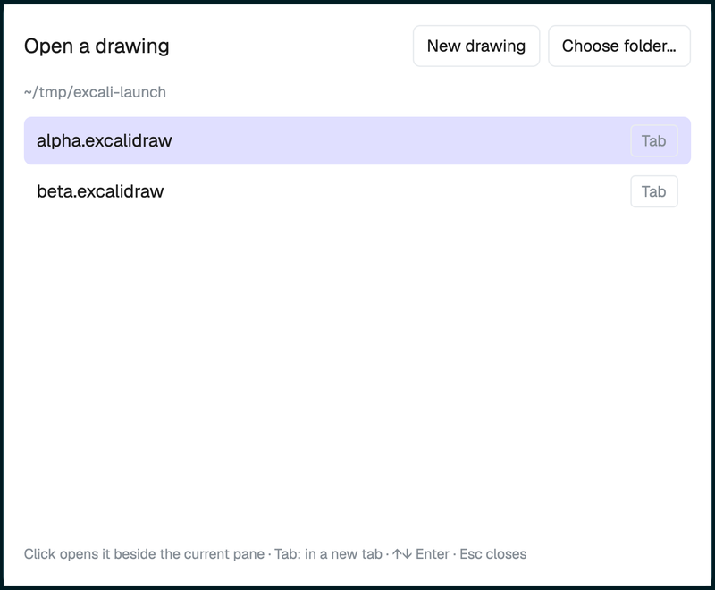
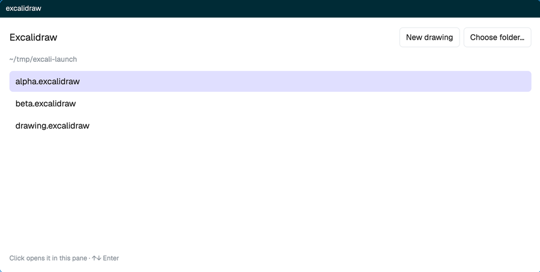

# Excalidraw for Herdr


Sketch diagrams right next to your terminals and agents. This [Herdr](https://herdr.dev) mod
opens `.excalidraw` files in a pane, draws them exactly like Excalidraw (same hand-drawn shapes,
from Excalidraw's own code), lets you draw and edit, and saves back to the file — so agents,
git and the Excalidraw web app all see the same drawing.

[한국어 요약](#한국어-요약)

## Install

Pick one:

- **Ask your agent** (in Herdr):
  `Read ~/.config/herdr-app/AGENTS.md, then add this mod: https://github.com/coyaSONG/herdr-excalidraw`
- **Copy it yourself**: copy `mods/excalidraw` into `~/.config/herdr-app/mods/`, and merge
  [`keys.json`](keys.json) into `~/.config/herdr-app/keys.json` (it binds <kbd>⌘⇧E</kbd>).
- **Build from source**: `bun install && node build.mjs --install` (then merge `keys.json` as above).

Then restart Herdr once so it loads the Excalifont handwriting font that comes with the mod.

## Open a drawing

**Press <kbd>⌘⇧E</kbd>** in any terminal.



- The list shows the `.excalidraw` files in **that terminal's folder**.
- **Click** one (or <kbd>↑</kbd> <kbd>↓</kbd> <kbd>Enter</kbd>) to open it **beside** the
  pane you were in. **Tab** opens it in a new tab instead.
- **New drawing** creates `drawing.excalidraw` (then `drawing-2`, …) and opens it.
- **Choose folder…** lists another folder. <kbd>Esc</kbd> closes.

Inside the editor, **Open…** in the bottom bar switches that pane to another drawing. A pane
opened without a file shows the same list in place, and remembers what you pick:



From a shell or an agent:

```sh
bin/herdr-excalidraw drawing.excalidraw          # beside the focused pane (--down, --tab)
herdr-app do pane.split --direction right --mod excalidraw --props '{"file":"/abs/path/drawing.excalidraw"}'
```

## Draw

| Tool | Key | |
|---|---|---|
| ↖ Select | <kbd>V</kbd> <kbd>1</kbd> | click, shift-click, drag a box; drag to move; double-click to edit text |
| ✋ Hand | <kbd>H</kbd>, or hold <kbd>Space</kbd> | drag to pan |
| ▭ ◇ ◯ Shapes | <kbd>R</kbd> <kbd>D</kbd> <kbd>O</kbd> | drag; <kbd>Shift</kbd> for square / circle |
| → ╱ Arrow, line | <kbd>A</kbd> <kbd>L</kbd> | drag; an arrow dropped on shapes sticks to them |
| ✎ Draw | <kbd>P</kbd> | freehand |
| T Text | <kbd>T</kbd> | click and type; <kbd>Esc</kbd> to finish |
| ⌫ Eraser | <kbd>E</kbd> | click or drag over things |

The panel on the left sets colors, fill, stroke and font size — for the selection, or for
what you draw next.

**Keys:** <kbd>⌫</kbd> delete · <kbd>⌘Z</kbd> undo · <kbd>⌘⇧Z</kbd> redo · <kbd>⌘A</kbd>
select all · arrows nudge · <kbd>Enter</kbd> edit text · <kbd>Esc</kbd> deselect.
**View:** scroll to pan · <kbd>⌘</kbd>/<kbd>Ctrl</kbd>+scroll to zoom · <kbd>⇧1</kbd> fit
everything · <kbd>⇧0</kbd> back to 100% · − / + in the bottom bar.
(<kbd>⌘=</kbd> <kbd>⌘-</kbd> <kbd>⌘0</kbd> stay Herdr's own zoom.)

## Saving and sync

- Every change is saved to the file about half a second later. The bottom bar shows
  *Saved / Unsaved / Saving…*.
- If the file changes on disk — an agent edits it, `git checkout`, the Excalidraw web app —
  the pane reloads it. If you had unsaved changes, a notification says so and
  <kbd>⌘Z</kbd> brings them back.
- Files keep everything they had, including elements this editor can't edit yet.

## Good to know

- Not here yet: resize and rotate handles, editing multi-point lines and elbow arrows, adding
  images, libraries, export. Such elements still show and are kept when saving.
- Herdr has no text measuring, so boxes around text are close but not exact. Excalifont has
  no Korean glyphs; Korean text uses a system font.
- With a Korean input method on, a shortcut letter can end up at the end of the next text you
  type. Use the toolbar, or switch to English input for shortcuts.
- Speed: about 1000 shapes on screen stay smooth; around 2000 it slows down.

## Development

- `src/main.js` — the pane: launcher and file list, file I/O, tools, pointer and keys, UI.
- `src/picker.js` — the drawing list (launcher and in-pane).
- `src/geometry.js` — elements to native paths, text and image boxes, layers.
- `src/document.js` — reading (with defaults for older files), writing, undo history.
- `src/shim.js` — browser globals the Excalidraw packages need, and a `setTimeout` queue.
- `build.mjs` — bundles into `mods/excalidraw/` (committed), patches roughjs for QuickJS,
  copies Excalifont; `--install` copies the mod into Herdr.

Check a build with `herdr-app check mods/excalidraw`. How the mod is built, and what to watch
out for, is in [RECIPE.md](RECIPE.md).

## Licenses

This project: MIT (`LICENSE`). The bundle includes Excalidraw's packages, MIT
(`licenses/excalidraw.txt`, copied into the mod as `LICENSE-excalidraw.txt`), with the code
`@excalidraw/element` bundles itself. Excalifont: SIL Open Font License 1.1 (`fonts/OFL.txt`
in the mod).

## 한국어 요약

Herdr 안에서 터미널 옆에 Excalidraw 그림을 열고 그리는 mod입니다.

1. **설치**: Herdr의 에이전트에게
   `Read ~/.config/herdr-app/AGENTS.md, then add this mod: https://github.com/coyaSONG/herdr-excalidraw`
   라고 하거나, `mods/excalidraw`를 `~/.config/herdr-app/mods/`에 복사하고 `keys.json`을
   합칩니다. 손글씨 글꼴을 쓰려면 Herdr를 한 번 재시작하세요.
2. **열기**: 터미널에서 <kbd>⌘⇧E</kbd> → 그 터미널 폴더의 `.excalidraw` 목록이 뜹니다.
   클릭하면 옆 pane에, **Tab**은 새 탭에 열립니다. **New drawing**으로 새 그림을 만듭니다.
   편집기 하단의 **Open…**으로 다른 그림으로 바꿀 수 있습니다.
3. **그리기**: 위 툴바나 단축키(V·R·D·O·A·L·P·T·E), 왼쪽 패널로 색과 채우기를 바꿉니다.
4. **저장**: 바꿀 때마다 자동 저장되고, 파일이 밖에서 바뀌면(에이전트, git) 다시 불러옵니다.
5. **참고**: 한글은 시스템 글꼴로 보입니다. 한글 입력기를 켠 채 단축키를 쓰면 다음 텍스트 끝에
   자모가 붙을 수 있으니 툴바를 쓰거나 영문 입력으로 바꿔 주세요.
