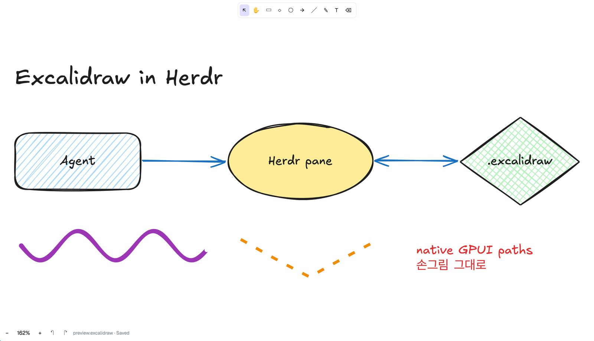

# Excalidraw

An Excalidraw editor in a Herdr pane: open a `.excalidraw` file beside your terminals, see it
drawn the way Excalidraw draws it (the same hand-drawn shapes, from Excalidraw's own
`@excalidraw/element`), draw and edit, and it saves back to the file. When the file changes on
disk (another editor, an agent, `git checkout`), the pane reloads it.



## What you see

- **A launcher**, on <kbd>⌘⇧E</kbd> (`mod.open:excalidraw`): a 560×460 dialog titled “Open a
  drawing” with “New drawing” and “Choose folder…” buttons, a gray line with the folder (`~`
  for home), a scrolling list of that folder's `.excalidraw` files (the highlighted row is
  `#e0dfff`, others white, hover `#f1f0ff`), a small “Tab” button on each row, and a hint at
  the bottom. The folder is the focused terminal's, else another terminal's in the tab, else
  home.
- **An editor pane**, opened from the launcher, or with `pane.split {direction, mod:
  "excalidraw", props: {file}}` / `tab.new {mod: "excalidraw", props: {file}}` (`file`
  absolute, `~/` works). A pane opened without a file shows the same list in place, titled
  “Excalidraw”, without the Tab buttons. Nothing is added to a layout: `mod.json` is
  `{ "place": "none", "title": "Excalidraw", "overlay": { "width": 560, "height": 460 } }`.
- The drawing's own canvas color (`appState.viewBackgroundColor`, white by default) fills the
  pane. Shapes are Excalidraw's: rough outlines, hachure / cross-hatch / solid fills, dashed and
  dotted strokes, rounded corners, arrows with arrowheads, free-draw strokes with pressure
  taper, text in Excalifont (bundled in `fonts/`), images, frames as dashed gray boxes with
  their name. Rotated shapes draw rotated; rotated text and images draw unrotated.
- A toolbar centered 8px from the top: a white card (1px `#e9ecef` border, 8px radius, 4px
  padding, 2px gaps) with ten 14px glyph buttons, each 8×4px padded with a 6px radius:
  `↖ ✋ ▭ ◇ ◯ → ╱ ✎ T ⌫` (select, hand, rectangle, diamond, ellipse, arrow, line, draw, text,
  eraser). The active tool's button is `#e0dfff`; hover is `#f1f0ff`.
- A style panel, 60px from the top and 8px from the left, while a drawing tool is active or
  something is selected: a white card (10px padding, 10px gaps, 8px radius) with rows, each an
  11px `#868e96` label over its options: Stroke (five 20px swatches `#1e1e1e #e03131 #2f9e44
  #1971c2 #f08c00`), Background (transparent shown as `∅`, `#ffc9c9 #b2f2bb #a5d8ff #ffec99`),
  Fill (`▤ ▦ ■`), Stroke width (1, 2, 4), Stroke style (solid, dashed, dotted), Sloppiness (0,
  1, 2), and Font size (S 16, M 20, L 28, XL 36) when text is involved. The current value has
  a 2px `#6965db` border or the selected background.
- A status row 8px from the bottom-left, 12px `#868e96`: `−`, the zoom percent, `+`, `↶`,
  `↷`, `Open…`, then `file name · Saved | Unsaved | Saving… | New file | Save failed: …`.
- Selection: a 1.5px `#6965db` outline 6px outside each selected element, a dashed one around
  several. The selection box is `#6965db` over a `#6965db1f` fill. The eraser outlines what it
  will remove with dashed `#e03131`. Text being edited sits in a dashed `#6965db` frame.
- The toolbar, panel and status row use that fixed light palette, not Herdr's theme: they
  float on the drawing's canvas, which is light.

## How it behaves

Choosing a drawing:

- In the launcher, a click on a row (or ↑/↓ and Enter) opens it with `pane.split {direction:
  "right", pane: <the pane focused when the launcher opened>, mod, props: {file}}` and closes
  the launcher; “Tab” opens it with `tab.new {name: <file name>, mod, props: {file}}`. With no
  focused pane it opens in a new tab. Escape closes.
- “New drawing” writes an empty drawing as `drawing.excalidraw`, else `drawing-2…`, in the
  listed folder (never overwriting) and opens it the same way. “Choose folder…” asks with the
  system folder picker and lists that folder.
- In a pane's own list, choosing opens the drawing in that pane and stores its path in the
  copy's `localStorage` (`file`), so the pane reopens it after a restart; Escape returns to
  the drawing it showed, if any. `Open…` in the status row saves, then shows that list.

| Tool | Key | Does |
|---|---|---|
| Select | `v` `1` | click selects (a group selects whole; text in a shape selects the shape), shift-click toggles, drag on empty canvas box-selects, drag a selection to move it, double-click text or a rectangle/diamond/ellipse to edit its text, double-click empty canvas for new text |
| Hand | `h`, hold `space` | drag pans; the middle button pans with any tool |
| Rectangle, diamond, ellipse | `r` `2`, `d` `3`, `o` `4` | drag from a corner; shift makes it square |
| Arrow, line | `a` `5`, `l` `6` | drag start to end; an arrow end dropped on or in a shape binds to it and snaps 4px off its outline |
| Draw | `p` `7` | freehand; the tool stays on |
| Text | `t` `8` | click places a text box; `escape`, `cmd-enter` or a click outside finishes; empty text is removed |
| Eraser | `e` `0` | click or drag over elements; they go on release |

- After drawing a shape, line or arrow the new element is selected and the tool returns to
  Select. Tiny drags (under 3 units) draw nothing.
- `backspace`/`delete` deletes the selection (with text inside shapes; arrows attached to
  deleted shapes come loose). Arrow keys nudge by 1 (shift: 10). `enter` edits the selected
  text or the selected shape's text. `escape` clears the selection and returns to Select.
  `cmd-a` selects everything. `cmd-z` undoes, `cmd-shift-z` and `cmd-y` redo (100 steps).
- Moving shapes drags the text inside them and keeps attached arrows attached. Moving an arrow
  without the shapes it is attached to detaches it.
- The panel sets the style of the selection (one undo step) and of what you draw next.
- Scroll pans, shift-scroll pans sideways. `cmd`/`ctrl`-scroll zooms about the pointer
  (`exp(-dy × 0.01)` per event, 10%–3000%). `+`/`−` zoom by 1.2 about the center; the percent
  button and `shift-0` return to 100%; `shift-1` fits the drawing (80px side margin, 120px
  vertical).
- Saving: 400ms after the last change, once no drag or text edit is in progress, the whole
  file is written with `writeTextFile(path, text, lastText)`. A file that doesn't exist opens
  empty and is created on the first change. Saved files keep every element, `appState` and
  `files` they had; deleted elements are left out.
- The pane watches the file's folder. A change from elsewhere reloads the drawing; if there
  were unsaved changes a warning notification says so, and undo brings them back. A save that
  finds the file changed loads the file's version the same way. An unreadable change posts a
  warning and keeps the drawing.
- Herdr's own zoom is read every 200ms; the drawing redraws at the new zoom.

## Built from

- **One mod**, `mods/excalidraw/`: `main.js` (one esbuild bundle), `mod.json`,
  `fonts/Excalifont-Regular.ttf` with `fonts/OFL.txt`, and license files. No `layouts/`.
- **A `keys.json` snippet**, merged into the person's keys (both sections, so it works while a
  terminal has focus):

  ```json
  { "global": { "cmd-shift-e": "mod.open:excalidraw" }, "terminal": { "cmd-shift-e": "mod.open:excalidraw" } }
  ```
- **Source** (`src/`), bundled by `build.mjs` (esbuild, ESM, platform neutral, `gpui-kit`,
  `gpui-base`, `herdr`, `buffer`, `fs/promises` external):
  - `main.js`: the pane `View`, in three states: the list (launcher or in-pane), loading/error,
    and the editor. Static drawing in retained child views
    (`cx.new(Layer, {idx})`, re-described only after a change), one live child view for what
    is being drawn or dragged plus selection outlines, and the toolbar, panel and status row in
    the root. Pointer handlers on a full-size canvas `div`; the drawing sits in a child `div`
    offset by the scroll. Keys on the root (`track_focus`, `on_key_down`); the text editor is a
    `Textarea` inside a `key_context("ExcalidrawTextEditor")` wrapper that ends editing on an
    `excalidraw_end_edit` action bound to `escape` with `cx.bind_keys`.
  - `geometry.js`: element → `ShapeCache.generateElementShape` (roughjs sets) →
    `PathBuilder` (`move_to`, `line_to`, `cubic_bezier_to`, `dash_array`), free-draw through
    `getFreeDrawSvgPath` and an SVG `M L Q T C Z` reader, rotation about the element center,
    opacity folded into `#rrggbbaa`. Elements are batched in z-order into non-overlapping
    groups (≤ 200) whose paths merge per style, and batches into layers of ≤ 40,000 path
    commands with their bounds; only layers near the view are mounted.
  - `document.js`: reading with defaults for fields older files lack (`strokeSharpness` →
    `roundness` and the like), writing through `clearElementsForExport` and
    `syncInvalidIndices`, snapshot undo.
  - `shim.js` (prepended): `self`, `navigator`, `document.createElement`, `Path2D` keeping its
    SVG string, and `setTimeout`/`clearTimeout` as a queue the pane drains every 200ms.
- **Excalidraw packages**: `@excalidraw/element`, `@excalidraw/common`, `@excalidraw/math` at
  `0.18.0-f0063e113` — `Scene`, `newElement`/`newArrowElement`/`newLinearElement`/
  `newFreeDrawElement`/`newTextElement`, `hitElementItself`, `hitElementBoundingBox`,
  `getElementBounds`, `getCommonBounds`, `getHoveredElementForBinding`,
  `bindOrUnbindLinearElement`, `updateBoundElements`, `fixBindingsAfterDeletion`,
  `getBoundTextElement`, `redrawTextBoundingBox`, `refreshTextDimensions`,
  `setCustomTextMetricsProvider`.
- **Herdr functions**: `props` (`file`, `overlay`), `settings` (zoom), `theme` (only for the
  loading/error message), `focused`, `panes`, `run` (`pane.split`, `tab.new`), `closeOverlay`,
  `pickFolder`, `readTextFile`, `writeTextFile`, `watchFolder`, `notify`, `home`, `appHome`;
  `fs/promises` `readdir`/`exists`/`mkdir`/`writeFile`; `localStorage`.
  `picker.js` is the list: folder listing, new-drawing names, keys, the rows.
- **What it touches**: no network, no `exec`, no `hc`. It lists folders you open the launcher
  in or choose, creates new drawings there, reads and writes the drawing it shows, watches
  that drawing's folder, and writes the drawing's embedded images (decoded from their data
  URLs) to `~/.config/herdr-app/data/herdr-excalidraw/` so `image()` can show them.
- **Helper**: `bin/herdr-excalidraw [--right|--down|--tab] FILE` resolves the path and runs
  `herdr-app do pane.split` / `tab.new` with the props.

## Watch out

- QuickJS has no `RegExp.$1`; roughjs's SVG path tokenizer (bundled inside
  `@excalidraw/element`) uses it, and rounded rectangles, diamonds and arrows then fail to draw.
  `build.mjs` replaces that one function at build time and fails the build if the pattern is
  missing or any `RegExp.$` remains.
- `@excalidraw/element` imports `@excalidraw/math/ellipse`, which that package exports for
  types only; alias it to `@excalidraw/math`.
- Herdr refuses `setTimeout` and `Function("return this")()`; `Scene` throttles with lodash,
  which needs both a `setTimeout` and a global `self`.
- Units: paths and pointer `local_position` are in GPUI pixels; `div` positions and text sizes
  are layout pixels (GPUI ÷ Herdr zoom). One scene unit is one layout pixel at 100%.
  `on_size_change` reports GPUI pixels.
- `line_height(n)` with a bare number is a multiple of the font size; pass `"25px"`.
- GPUI fills cancel where loops of one path overlap. roughjs fills an ellipse as two nearly
  identical loops, so each loop of a solid fill needs its own path.
- One render has an execution deadline: a single path of ~3,000 hatched shapes is interrupted,
  so keep layers bounded. Notifying the root re-describes every mounted layer: draw live
  changes in their own retained view.
- `TextareaState.focus()` before the textarea is mounted leaves keys with the canvas, where
  letters switch tools. Focus it on the next frame.
- Herdr owns `cmd-=`, `cmd--` and `cmd-0` (its own zoom). Shift+1 and Shift+0 reach the pane as
  `!` and `)` with shift already consumed.
- There is no text measuring API: text boxes come from an estimate (0.55 em per Latin glyph,
  1 em for CJK and Hangul), so selection boxes around text are approximate. Excalifont has no
  Hangul; it falls back to a system font. Mod fonts load at Herdr start or on a look change.
- With a Korean input method on, a tool shortcut letter can stay in the composition and land
  at the end of the next text typed.
- Not built: resize and rotate handles, multi-point line editing, elbow arrows, adding images,
  libraries, export. Those elements still draw and round-trip.

## Done when

- `herdr-app check mods/excalidraw` passes.
- In a terminal whose folder has two drawings, <kbd>⌘⇧E</kbd> shows both; Enter opens the
  first beside the terminal; “Tab” on the second opens it in a new tab named after it; “New
  drawing” creates `drawing.excalidraw` and opens it empty. <kbd>⌘⇧E</kbd> from an editor pane
  lists the same folder.
- `pane.split` with the mod and no props shows the list in the pane; Enter opens the first
  drawing there; `Open…` then ↓ Enter switches that pane to the second.
- A drawing with a rounded hachure rectangle holding centered text, an arrow bound to a
  cross-hatched ellipse, a rotated solid diamond, a dashed thick line, a free-draw stroke and
  two-line text with Hangul opens drawn like Excalidraw: fills present (a solid ellipse is
  filled, not hollow), text inside its shape, nothing dashed-gray except frames.
- Click a shape, `backspace`: it and its text leave the file within a second; `cmd-z` brings
  both back to the file.
- Dragging with the rectangle tool adds a rectangle of the dragged size to the file; the
  draw tool adds a free-draw element; an arrow dragged from one shape into another is saved
  with `startBinding` and `endBinding` and ends just outside both outlines.
- Text tool, click, type, `escape`: the text is in the file. Selecting text and `enter`,
  typing, `escape` edits it in the file.
- Selecting a shape and a stroke swatch changes its `strokeColor` in the file. The eraser
  removes what it is clicked on.
- Editing the file from outside redraws the pane within a second.
- `+` zooms 1.2× about the canvas center, the percent button and `shift-0` return to 100%,
  `shift-1` fits the drawing, scrolling pans.
